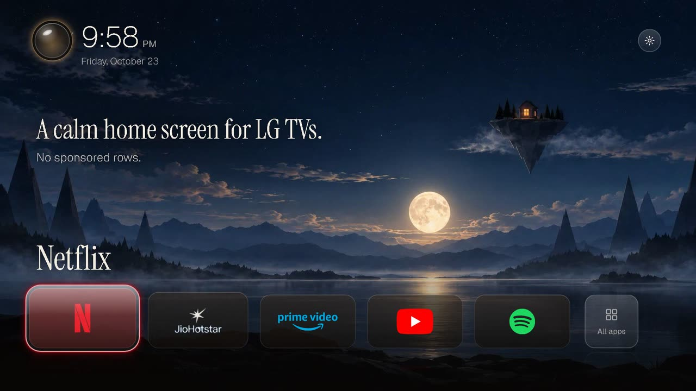

# Haven — a calm home screen for LG webOS

[](https://cdn.jsdelivr.net/gh/yashm24-collab/haven@fdeee60/docs/haven-showcase.mp4)

**[Watch the 25-second showcase](https://cdn.jsdelivr.net/gh/yashm24-collab/haven@fdeee60/docs/haven-showcase.mp4)** (sound on): the TV turning on to "Welcome home", the
dock, the time of day and the World Clock. It was made with Remotion from Haven's own stylesheet, videos and
brand marks.

Haven is a redesigned launcher for [Clean Your TV — LG webOS](https://github.com/Razdva122/clean-your-tv-lg-webos).
It keeps that project's installer, Home Helper and recovery path, and replaces what you see:

- **A landscape that follows the day.** Morning, day and night pictures with slow mist and light on
  the water, looping without a seam.
- **"Welcome home" at power-on.** A five-second intro that ends on the first frame of Home. Any
  button skips it.
- **Five apps on dark glass.** Brand marks on the dock; the focused app glows in its own colour and
  grows slightly. **All apps** holds the rest, the TV's inputs and LG's apps.
- **A glass orb that opens a World Clock.** Up to eight cities on a glowing globe, with the current
  weather.
- **Quiet type and motion.** Instrument Serif and Geist; motion uses only transform and opacity,
  with no bounce.

**Tested on one TV only:** LG 50UA83506LA (webOS 25), No-root Edition. A successful install does not
mean it works on your TV: run the [installation checks](docs/INSTALL.md#7-verify-before-daily-use).
Dock motion has not been re-measured on the TV since the last change. Root Edition and Software
updates are not adapted to Haven (Haven hides the Software updates button).

### Install Haven

The installer is unchanged: `./install.sh <TV IP>` (see [Get started](#get-started)) builds and
installs Haven together with Home Helper. The dock shows the first five installed apps from
`dockApps` in `launcher/config.js`, and fills any free places from your app list.

To reinstall only Haven after a change (Node.js 20+):

```sh
(cd lumen && npm ci)
DEVICE=<your ares-setup-device name> lumen/install.sh
```

`lumen/install.sh` also makes the JioHotstar dock mark from your TV's own icon. That file stays on
your computer; without it, the tile shows the TV's icon.

### Your own landscapes

The pictures and videos in `launcher/assets/` are prebuilt. To use your own, save pictures of at
least 1920×1080 with no text as `lumen/public/scene-morning.jpg`, `scene-day.jpg` and
`scene-night.jpg`, then run `bash lumen/render.sh` (Remotion; it takes a while). Remotion is free
for individuals and small companies; see its [license](https://www.remotion.dev/license).

### Network and stored data

- The only network request goes to `api.open-meteo.com`, while the World Clock is open (when it
  opens, then every five minutes), with the coordinates of the listed cities. No key or account.
- Haven keeps four values in the launcher's local storage: `lumen.cities` (World Clock cities),
  `lumen.wx` (the last weather), `lumen.last` (the dock app to focus) and `lumen.still` (Pause scene
  motion).

The rest of this page is the upstream README. It still describes the installer, Home Helper, the
remote controls and recovery; its screenshots show the original launcher.

---

## Clean Your TV — LG webOS

**A clean home screen for LG webOS. No root. No always-on computer.**

Keep your favorite apps in a personal dock and app grid, without sponsored rows
in this launcher. The launcher and optional **Home Helper** run on the TV itself:
your computer can be switched off after setup.

The released setup described here is No-root Edition. Developer Mode must remain
active; local networking is needed for the helper’s power/foreground monitoring.

- **No root or firmware flashing** — installed through LG Developer Mode.
- **No always-on computer, Raspberry Pi or router script** — Home-button handling runs on the TV.
- **Home opens your launcher** — a short press returns to it while Home Helper is active.
- **A way back to LG Home** — hold Home for about two seconds to stop the helper.

Based on [webos-vibehack](https://github.com/OmkarK97/webos-vibehack), with Home-button
handling moved from an external watcher to an on-TV native helper.

[Live preview](https://razdva122.github.io/clean-your-tv-lg-webos/) · [Install](docs/INSTALL.md) · [Recovery](docs/RECOVERY.md) ·
[Compatibility](docs/COMPATIBILITY.md) · [Build](docs/BUILD.md) · [Update & remove](docs/MAINTENANCE.md)

## Choose your edition

| Edition | Status | Start here |
| --- | --- | --- |
| **No-root** | Released, recommended for daily use; launcher and helper run on the TV | [Installation](docs/INSTALL.md) |
| **Root Edition** | Separate preview; native Home/Back routing, permanent mode and recovery tested on one C3 | [Overview and evidence](root-edition/README.md) |

Both use the same Home interface. Root Preview provides native system routing
for Home and confirmed Back exits without an observed LG flash on the tested C3.
It installs separately; final-artifact cold-boot and failsafe acceptance remains open. [Compare requirements, controls and limits](docs/EDITIONS.md).
The features and remote-control guide below describe **No-root Edition**.


*Launcher 1.0.11, rendered locally with an example five-app configuration.
Your apps and their order are configured during setup; they are not bundled.*

## What you need

A computer is needed to build, install and configure the launcher and helper,
and later for app-list changes and software updates. It is not needed for everyday use.
LG Developer Mode must remain active. A working local network is still needed
for the helper's paired power and foreground monitoring.

Compatibility varies by model, remote and firmware; see [compatibility and known limits](docs/COMPATIBILITY.md)
before installing. Not affiliated with LG.

## What it does

| Feature | Behavior |
| --- | --- |
| Personal home screen | Local app grid, configurable dock, hidden tiles and tile ordering; no sponsored rows in this launcher |
| Short Home | Native on-TV interception returns to the launcher without passing through LG Home on the tested setup |
| Hold Home for 2 seconds | Stops interception and returns to LG Home |
| Resume interception | Select **Resume Home** in Home, or manually open **Home Helper** from LG Apps |
| Wi-Fi shortcut | Opens LG's network setup overlay |
| Automatic startup | Returns after standby and cold boot using input restoration plus a guarded fallback helper; no external device runs the startup logic |
| Exit with Back | Returns after watched apps exit, preserving in-app navigation and exit confirmation; LG Home can briefly flash |
| Quick standby/resume | Avoids relaunching a launcher already restored by webOS, preserving arrows and OK after a fast power cycle |
| Remote controls | Arrows, held arrows, OK, volume and pointer remain usable; wheel events are forwarded |
| Failure recovery | Watchdog cleanup releases interception if the handler stalls; long Home provides a manual escape |
| Local interface | App tiles, font and splash assets are stored locally; the menu does not wait for an Internet download |

This does not remove system advertisements, uninstall apps, or replace the operating
system's Home destination. It provides an alternative screen. Cold boot still has
an initial black interval; early display timing is under investigation.

## How it works

**Home** is the app launcher. **Home Helper** handles the Home button and watches
for exits from configured apps. Both run on the TV. The helper leaves ordinary
in-app Back navigation, exit confirmations and the other remote controls intact.


*Illustrated controls and example screens; button layout varies by remote.*

**Hold Back exits the app; hold Home stops the helper.** When the helper is active,
it returns to our launcher after a watched app exits through LG Home. That path
can briefly show LG Home; it is not the same direct path as short Home.

### Remote control guide

| Button | What it does |
| --- | --- |
| **Arrows / hold an arrow** | Move through tiles and menus; normal navigation inside apps. |
| **OK / pointer click** | Open the selected app or activate a control. |
| **Short Home** | Return directly to our launcher while Home Helper is active. With the helper stopped, LG handles Home normally. |
| **Hold Home ~2 seconds** | Emergency exit: stop the helper and open LG Home. Preferences are kept; this is **not a factory reset**. |
| **Short Back** | Go back inside the current app. Its exit dialog and Cancel action still work normally. On a confirmed exit from a watched app, the helper returns to our launcher. |
| **Hold Back** | Use webOS's exit-to-Home action. It **does not stop the helper**; the exit watcher can then return to our launcher. |
| **Volume + / −, mute** | Normal TV/audio controls. |
| **Move the Magic Remote / wheel** | Pointer and wheel events pass through. Wheel-to-tile selection is not implemented in our launcher. |
| **Power** | Normal TV standby/wake. With startup configured and the helper not stopped, our launcher returns automatically; cold boot still takes time. |
| **Hold 1, if assigned** | Open Home using LG Quick Access. This shortcut must be assigned during setup; it does not resume a stopped helper by itself. |

### Resume after an emergency exit

1. Open **Home** from LG's app list, or use your assigned Quick Access shortcut.
2. Select **Resume Home** in the top action row.
3. The helper starts and the button disappears. Short Home works again.

Opening Home alone does **not** clear the emergency stop. The Resume Home button
uses the system's helper-presence signal: it appears when the helper is disconnected
and stays hidden while it is connected. If that status cannot be read, open
**Home Helper** directly from LG's app list instead. No additional LS2 permission
is required. A single-instance lock prevents duplicate controllers.

The UI above describes the **1.1.0 launcher** with helper **0.6.13**.
Older release packages may call the helper **Native Home Prototype** and lack the
Resume Home button; manually opening that helper performs the same recovery.
The long-Back action is documented by [LG's remote guide](https://webostv.developer.lge.com/develop/guides/magic-remote);
app-specific exit behavior can vary. See [Recovery](docs/RECOVERY.md) for troubleshooting.

## Get started

On the TV, enable **Developer Mode** and **Key Server**. On a Mac or Linux computer
with **Node.js 20+ (including npm), Python 3.9+ and Git**, run:

```sh
git clone https://github.com/Razdva122/clean-your-tv-lg-webos.git
cd clean-your-tv-lg-webos
./install.sh 192.168.1.50
```

Replace the address with your TV's IP. The script prepares local tools, pairs with
the TV, reads your apps, builds and installs both packages, configures Home Helper
and requests its launch. Enter the Developer Mode passphrase when prompted and
accept the remote-control pairing request on the TV. No manual helper build or
configuration is needed. No root or `sudo` is used.

Once installed, check short Home, hold Home for two seconds to test recovery, and
check standby/wake and cold boot. **Hardware compatibility still needs to be
verified on your TV.** See the [installation guide](docs/INSTALL.md) for prerequisites,
manual installation and recovery. Windows installation has not been tested.

## Browser preview

[Try the live launcher preview](https://razdva122.github.io/clean-your-tv-lg-webos/).
It uses demo apps and simulated TV functions. GitHub Pages automatically deploys
the latest `main` after tests pass.

### Run locally

Preview the actual launcher without a TV or extra dependencies (Python 3.9+):

```sh
python3 scripts/preview.py --open
```

Open http://127.0.0.1:8765/ if the browser does not open automatically. The
1920×1080 TV canvas scales to fit the window. Use the mouse, arrow keys and
Enter; hold Enter to rearrange a tile, and use Esc to go back in panels.
The preview uses ten demo apps with scalable SVG brand logos and simulated webOS
services. It never connects to a TV or performs real launches, renewals or updates.

Save changes in `launcher/` or `preview/` and the page reloads automatically
within about a second. The server reads sources on each request and disables
caching. Tile order is saved in the
browser's local storage. Stop with Ctrl+C; use `--port 8766` if the port is busy.
Only launcher assets and preview files are served, on the loopback interface.
The preview adapter is injected by the server and is not included in TV packages.
Logo sources are recorded in `preview/icons/SOURCES.txt`.

## Developer Mode auto-renewal — Beta

Home 1.1.0 adds **Settings → Enable Beta**. It is off by default and aims to renew
the session directly on the TV, without external devices. **Real renewal still
needs validation: keep monitoring your official Developer Mode timer.**
See [setup, status and feedback instructions](docs/DEVELOPER-MODE-BETA.md).

## Tested release

Current release: launcher **1.1.0** + unchanged helper **0.6.13**. The new Beta
service and settings panel are locally tested; integrated real renewal is not
yet validated. The previous launcher **1.0.13** added the tested recovery UI,
app names, icons and hover labels. The native input/watchdog code is unchanged
from helper 0.6.12. Two quick standby/resume cycles passed after
the focus fix, including arrows, OK and short Home. Earlier tests covered volume,
pointer, long-Home recovery and watchdog cleanup. The public build uses your
locally generated app configuration; follow the [installation checks](docs/INSTALL.md#7-verify-before-daily-use)
to verify the setup on your TV.

Developer Mode must remain active. A LAN outage can affect the optional power and
foreground watcher. Wheel input is forwarded, but wheel-to-tile selection is not
implemented. See [known limits](docs/COMPATIBILITY.md).

## Project layout

```text
launcher/          Web launcher and local splash image
native/app/        Home controller, policies and native entry point
native/prototype/  Remote relay/filter source and tests
native/service/    Guarded startup service
scripts/           Build and setup tools
docs/              Installation, edition comparison, recovery and limitations
root-edition/      Read-only doctor, local metadata planner and development gates
```

## Credits

Built on the work of [OmkarK97/webos-vibehack](https://github.com/OmkarK97/webos-vibehack)
and [Gathin23/cleanyourtv](https://github.com/Gathin23/cleanyourtv).
MIT-licensed project code; Outfit uses SIL OFL and the bundled ws library uses MIT.
Haven's fonts, Rive runtime, brand marks and weather data are listed in the notices.
See [LICENSE](LICENSE) and [third-party notices](THIRD_PARTY_NOTICES.md).

No firmware images, extracted proprietary binaries, TV credentials or personal
app inventories are included. Please redact logs before opening an issue.

## Software updates

Rooted TVs with Homebrew Channel can use **Settings → Software updates** with a separate Home Updater recovery app. Signed releases preserve your apps and settings and pause renewal automatically during installation. Start with the [setup and recovery guide](docs/UPDATES.md). No-root users continue updating from their computer. Existing Home versions below 1.2.0 require a personalized rebuild first; generic release packages do not contain your app inventory.
